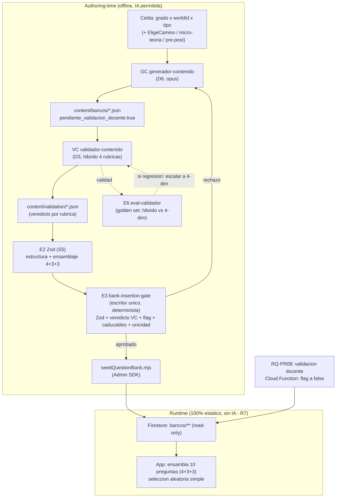
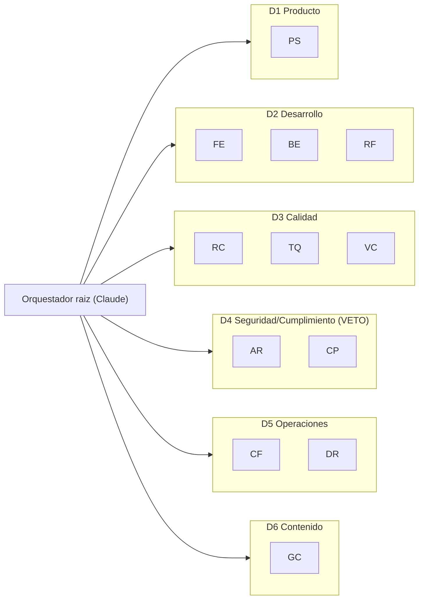

# Diseño del arnés — Ceti (Fase 3)

> **Documento vivo.** Especifica el arnés completo (departamentos, agentes, rules,
> skills, enforcement) que se materializará en **Fase 4**. Esta fase es **solo
> diseño**: no se toca código ni se crean archivos del arnés.
>
> **Orden de autoridad** (D0): `docs/empresa/decisiones.md` > resto de
> `docs/empresa/` > `docs/requerimientos.md` (v2) > `conflictos.md`/`estado.md` >
> este documento / rules / `CLAUDE.md` > repo/código.
>
> `harness-design.md` **absorbe y reemplaza** a `docs/HARNESS.md` y `AGENTS.md`
> (ambos describen el modelo pre-pivot). Fecha base: 2026-06-05.

---

## Estado de validación (pieza por pieza)

- **Fase A — Preguntas:** ✅ cerrada (decisiones + matices abajo).
- **Fase B — Inventario:** ✅ aprobado.
- **Fase C — Validación pieza por pieza:** ✅ completa.
  - Rules: **R1–R15 + CR1–CR4** ✅.
  - Skills: **S1–S9** ✅.
  - Agentes (D1–D6): **12 agentes** ✅.
  - Enforcement: **E1–E11** ✅.
- **Fase D — Documento final:** ✅ completa (pipeline mermaid, mapa de deptos, plan
  de demolición, orden de implementación de RQ).

> **Fase 3 COMPLETA.** Siguiente: Fase 4 — materialización en orden rules → skills →
> agentes → enforcement.

---

## Fase A — Decisiones y matices (cerrados)

Target runtime: **Claude Code**, archivos reales materializables en Fase 4.

- **A:** rules en `CLAUDE.md` + `.cursor/rules/*.mdc` (lo que el motor sí carga; no
  `.claude/rules/`). Departamentos = subcarpetas `.claude/agents/dN-*/`. Prosa en
  español; identificadores/campos/comandos en inglés.
- **B:** tres capas de enforcement — (1) hook `PostToolUse` (feedback al agente),
  (2) husky `pre-commit` (gate local barato), (3) CI (gate duro de merge). Scripts
  Node `.mjs` cross-platform (Windows + CI Linux). Bloqueantes: compliance/invariant
  lint, gate de bancos, typecheck, lint, test, test:rules.
- **C:** pipeline de contenido = agentes/Workflow de Claude Code generan JSON de
  banco en `content/`; gate de inserción + siembra = scripts deterministas.
  Validador de contenido **híbrido multi-rúbrica**. Bancos como JSON versionados
  bajo `content/`. Set dorado: formato/ubicación/runner los define el arnés; el
  usuario llena los casos.
  - **C3-matiz:** el eval (E6) mide explícitamente _híbrido vs. 4 dimensiones
    separadas_; si el híbrido deja pasar errores, se escala a validadores separados
    al menos en **precisión financiera** y **pedagógico**.
  - **C4-matiz:** cifras caducables (SMMLV/UVT/tasas) nunca quemadas → archivo de
    constantes anuales (invariante R14). "Neutro" = tono, no borrar contexto-país.
- **D:** refactor ejecuta tras gates de forma autónoma, **excepto** la migración
  atómica de `studentId`, que requiere **aprobación manual del plan de diff**
  (D1/D2-matiz). Borrado real de lo retirado; `sede` queda inerte.
  - **D3-matiz:** antes de cualquier demolición, **tag git `pre-pivot`** como punto
    de retorno (el historial es la cuarentena).
- **E:** `harness-design.md` absorbe `HARNESS.md` + `AGENTS.md`.
- **F:** sesgo a enforcement determinista; agentes LLM solo en juicio irreducible.
  Tier de modelo asignado por agente (ajustable).

---

## Fase B — Inventario aprobado

**Conteo:** 15 invariantes (R1–R15) + 4 convention rules (CR1–CR4) · 9 skills
(S1–S9) · 12 agentes en 6 departamentos · 11 piezas de enforcement (E1–E11).

### Códigos

- **Agentes:** PS (producto-scope) · FE (frontend-rn-web) · BE (backend-firebase) ·
  RF (refactor-migracion) · RC (revisor-codigo) · TQ (testing-qa) · VC
  (validador-contenido) · AR (auditor-firestore-rules) · CP (compliance-privacidad)
  · CF (costos-firebase) · DR (devops-release) · GC (generador-contenido).
- **Departamentos:** D1 Producto · D2 Desarrollo · D3 Calidad · D4 Seguridad y
  Cumplimiento (veto) · D5 Operaciones · D6 Contenido (authoring-time).
- **Skills:** S1 add-firestore-repository (REESCRIBIR) · S2 add-zustand-mmkv-store
  (REUSAR) · S3 add-screen (REUSAR) · S4 firestore-rules-matrix (NUEVO) · S5
  content-schemas (NUEVO) · S6 content-authoring-pipeline (NUEVO) · S7
  compliance-ley1581 (NUEVO) · S8 refactor-pivot (NUEVO) · S9
  add-cloud-function-claims (NUEVO).
- **Enforcement:** E1 hook-postedit · E2 content-zod-schemas · E3
  bank-insertion-gate · E4 invariant-lint · E5 slash-commands · E6 eval-validador ·
  E7 rules-matrix-tests · E8 rq-citation-check · E9 pre-pivot-tag-guard · E10
  ci-pipeline · E11 precommit-hook.

### Veredicto del arnés viejo

| Pieza                                                           | Veredicto                              |
| --------------------------------------------------------------- | -------------------------------------- |
| `CLAUDE.md`                                                     | REESCRIBIR (ancla v2)                  |
| `.cursor/rules/ceti-invariants.mdc` (CR1)                       | REESCRIBIR                             |
| `.cursor/rules/expo-rn-typescript.mdc` (CR2)                    | REUSAR (wording)                       |
| `.cursor/rules/firebase-modular-client.mdc` (CR3)               | REESCRIBIR (paths)                     |
| `.cursor/rules/zustand-stores.mdc` (CR4)                        | REUSAR                                 |
| `.claude/skills/add-firestore-repository`                       | REESCRIBIR                             |
| `.claude/skills/add-zustand-mmkv-store`                         | REUSAR                                 |
| `.claude/skills/add-screen`                                     | REUSAR                                 |
| `docs/HARNESS.md`                                               | REESCRIBIR → absorbido aquí            |
| `AGENTS.md`                                                     | REESCRIBIR → absorbido aquí            |
| `scripts/testFirestoreRules.mjs`                                | REESCRIBIR → E7                        |
| `scripts/seedQuestionBank.ts`                                   | REESCRIBIR → E3                        |
| `scripts/checkI18nKeys.mjs`                                     | REUSAR                                 |
| `scripts/seedDemoColegio.ts` / `seedScenario.ts` / `setRole.ts` | REESCRIBIR                             |
| `scripts/setSuperadmin.ts`                                      | ELIMINAR                               |
| `.husky/pre-commit`                                             | REESCRIBIR → E11                       |
| `.github/workflows/ci.yml`                                      | REESCRIBIR → E10                       |
| `docs/data-model.md`, `docs/COMPLIANCE.md`                      | target de refactor (no pieza de arnés) |

**Targets de demolición en código** (ejecuta RF; plan en Fase D): `certificate.ts`
(ELIMINAR) · `services/ai/*` + `adaptiveQuiz.ts` (ELIMINAR) · `aiProfile`
path/rule (ELIMINAR) · colección `autorizaciones` + tipo `Autorizacion` con PII
(REEMPLAZAR por atestación) · `sede*` (INERTE) · `studentId` en
rules/paths/tenancy/functions (MIGRACIÓN ATÓMICA con aprobación manual).

### Tabla 1 — RQ → piezas (sin huérfanos)

Reproducida íntegra en **Fase D → "Tabla 1 — RQ → piezas (cobertura completa)"**
(RQ-FN01..FN12, ES01..ES09, PR01..PR09, IN01..IN05, AD01..AD06, TS01..TS04,
CN01..CN05; ningún RQ huérfano).

### Tabla 2 — Falencia → piezas

| Falencia                 | Rules          | Agentes | Enforcement  | Skills |
| ------------------------ | -------------- | ------- | ------------ | ------ |
| Seguridad datos menores  | R1,R2,R4,R5,R6 | AR, CP  | E4, E7       | S4, S7 |
| Testing                  | R12            | TQ, RC  | E7, E10, E11 | S4     |
| Control de alcance       | R13            | PS      | E8           | —      |
| Costos Firebase          | R8             | CF      | E10          | —      |
| Calidad pedagógica       | R8, R14        | GC, VC  | E2, E3, E6   | S5, S6 |
| Refactor de código viejo | R1,R3,R5,R6,R7 | RF      | E4, E9       | S8     |

### Tabla 3 — Conflicto → piezas

| #   | Conflicto              | Sev.    | Piezas                                     |
| --- | ---------------------- | ------- | ------------------------------------------ |
| 1   | Llave `studentId`      | CRÍTICA | RF+BE+AR+E4+E7+R1, S8, _aprobación manual_ |
| 2   | Perfil del menor       | ALTA    | RF+CP+FE+E4+R5                             |
| 3   | Sedes activas          | ALTA    | RF(inerte)+AR+R2                           |
| 4   | Rol admin Ceti         | ALTA    | BE+RF+AR+E4+E7+R3, S9                      |
| 5   | Certificados PDF       | MEDIA   | RF+E4+R11                                  |
| 6   | Autorización acudiente | ALTA    | RF+BE+CP+E4+E7+R6                          |
| 7   | IA en runtime          | ALTA    | RF+E4+R7; GC/VC authoring                  |
| 8   | Bancos de contenido    | CRÍTICA | BE+GC+VC+E2+E3+R8, S5/S6                   |
| 9   | Tipos de pregunta      | MEDIA   | FE+E2+R9                                   |
| 10  | Narrativa de mundos    | MEDIA   | FE+i18n+GC                                 |
| 11  | Pre/Post-test          | BAJA    | FE+BE+GC                                   |

---

## Fase C — Piezas validadas

### Capa 1 — Rules (invariantes duros R1–R15)

Ubicación canónica: `.cursor/rules/ceti-invariants.mdc`, sección "Invariantes duros
(R1–R15)" (reescritura = CR1). Ancla de 1 línea por cada una en `CLAUDE.md`. La
parte mecánicamente verificable de cada rule tiene un grupo-espejo en `E4`/`E7`
(la _norma_ vive en la rule; el _check_ en enforcement; el _juicio_ en los agentes
D4) — sin duplicación de contenido.

**R1 — Identidad por email; clave `uid`.** El estudiante se identifica por su cuenta
OAuth: la clave de `estudiantes/{uid}` es el `uid` de Auth, y se almacenan
únicamente `email` y `nombre`. Prohibido el seudónimo `studentId` como llave, campo
o claim en cualquier capa (`firestore.rules`, `paths.ts`, `tenancy.ts`, `functions/`,
claims). _(RQ-FN02 · conflicto #1)_ — Espejo: E4 grupo `studentId`, E7
`isEstudianteSelf(uid)`.

**R2 — Autorización solo por custom claims.** Reglas y backend autorizan
exclusivamente con `request.auth.token.{role, colegioId, cursoId}`. Ningún campo
escribible por el cliente es autoritativo; los claims los fija solo una Cloud
Function. No existen claims `sedeId` ni `studentId` activos. _(RQ-FN03, RQ-FN01)_ —
Espejo: E4 grupo `claims`, E7 "campo cliente miente vs. claim".

**R3 — Tres roles; `admin` es claim de backend.** Enum exacto `{admin, profesor,
estudiante}` en `tenancy.ts`, `functions/`, `firestore.rules` (D-PIVOT: `rector` y
`coordinador` eliminados). `admin` es rol con claim de alcance global (sin
`colegioId`), **solo de backend** (Admin SDK, sin UI), no allowlist de email. Ningún
adulto se auto-asigna rol. Retirado `isSuperAdmin`/`CETI_SUPERADMIN_EMAILS`.
_(RQ-FN06, RQ-AD03, D7, D-PIVOT · conflicto #4)_ — Espejo: E4 grupo `roles`, E7 fila "admin G".

**R4 — PII mínima del menor.** En el perfil del estudiante solo `email` y `nombre`.
Prohibido edad, fecha de nacimiento, documento, teléfono, dirección o **grado** en
el doc del estudiante/claims/membership; el grado vive en `curso.grado`. Toda PII
extra requiere R15. Analytics nunca recibe PII de menor. _(RQ-FN02 CA2, D9)_ —
Espejo: E4 grupo `pii-menor` (lista blanca de campos), agente CP.

**R5 — Sin perfil individual del menor.** Prohibido construir/persistir
perfil/rasgo/etiqueta individual derivado del comportamiento. No existe `aiProfile`.
"Elige tu camino" y todo diagnóstico = solo agregados por curso
(`cursos/{cursoId}/agregados/*`); una decisión incrementa un contador agregado y
nunca se guarda por estudiante ni revela quién eligió qué. _(RQ-FN09, RQ-ES06, D4 ·
conflicto #2)_ — Espejo: E4 grupo `perfilamiento`, E7, agente CP.

**R6 — Atestación ligera; cero PII de acudiente.** La autorización del acudiente se
recolecta fuera del sistema. In-system solo un booleano `atestado` en
`estudiantes/{uid}` (+`atestadoPor`+`atestadoAt`+`politicaVersion`) que un rol
autorizado marca para activar. Prohibido guardar PII del acudiente y la colección
`autorizaciones` con `canalEvidencia`/`acudienteRef`. El acudiente no tiene cuenta
ni pantalla. Mientras `estado!='activo'`, las reglas impiden escribir
progreso/impactTest. _(RQ-FN10, D9 · conflicto #6)_ — Espejo: E4 grupo `acudiente`,
E7 `estudianteActivo`. Estado destino: `pendiente_atestacion|activo|suprimido`.

**R7 — Runtime estático; IA solo authoring-time.** En runtime la app solo lee del
banco: ninguna generación/adaptación/selección por modelo en vivo. Prohibido en
runtime `aiService.adaptQuestion`, `getRecommendedPath`, `analyzeWeaknesses`,
`adaptiveQuiz`, campos `aiHints`/`isAdaptable`. La selección de las 10 preguntas es
estática/aleatoria simple. IA solo en authoring-time (D6, offline). El diagnóstico
por reglas (no ML) se conserva. _(RQ-CN03, RQ-PR05 CA3, D5 · conflicto #7)_ —
Espejo: E4 grupo `runtime-ia` (discrimina por ruta; `content/`+`scripts/` exentos),
agente RC.

**R8 — Bancos por `grado×mundo×tipo`, read-only, sembrados.** Contenido en
`bancos/{grado}_{worldId}_{tipo}` (tipos `multiple_choice|true_false|ordenar`) y
`bancosEligeCamino/{grado}_{worldId}` (separado, ítems con 2 opciones sin
`correctAnswer`). Cobertura: 45 quiz + 15 Elige-camino. Todo nace
`pendiente_validacion_docente:true`, `generadoPor:'ia'`, `version`. Read-only para
todo cliente (incluido admin UI): siembra vía Admin SDK; la validación docente
cambia el flag vía Cloud Function. No existe `questionBank` global ni
`fill_blank`/`calculation`. _(RQ-FN07, RQ-CN05, RQ-PR08 · conflicto #8, prepara #9)_
— Espejo: E4 grupo `bancos`, E7 `write:false`, E2/E3 estructura+flag.

**R9 — Quiz de exactamente 10 ítems, 3 tipos.** Cada quiz = 10 ítems del banco
`grado×mundo`, mezcla **4 MC + 3 V/F + 3 ordenar**. Tipos `multiple_choice`,
`true_false`, `ordenar` (drag-to-rank; orden canónico nunca expuesto antes de
responder). Prohibido `fill_blank`/`calculation` u otro número. Calificación
determinista e inmediata (`ordenar`: score parcial por posición). _(RQ-ES03,
RQ-ES04 · conflicto #9)_ — Espejo: E2 (length==10, conteo por tipo), E4 grupo
`bancos`, agente TQ.

**R10 — Sin dinero real; sin ranking público individual.** Todo monto del simulador
y goals de ahorro = moneda virtual simulada; prohibido dinero real, cuentas
bancarias, gift cards. Gamificación atada a `mastery`, no al tiempo. Prohibido
leaderboard global/público/inter-colegio; permitido solo leaderboard de aula
(acotado al curso, `curso.colaboracionAula`), sin más PII que el nombre dentro del
curso. Pre/post-test no otorga XP/badges ni altera `mastery`/desbloqueo. _(RQ-ES05,
ES08, ES09, TS04)_ — Espejo: E4 grupo `dinero-leaderboard`, E7 scope de aula, TQ.

**R11 — Features excluidas (permanente).** Excluidos y prohibidos sin R15:
certificados/diplomas PDF (`buildCertificateHtml`), reporte/app para padres y todo
login/dashboard de acudiente, facturación in-system, **sedes activas** (sede
dormante: `sedesEnabled:false`, sin docs en `sedes/`, ninguna pantalla la
requiere), IA generativa/adaptativa en runtime (R7), modelo
`parent`/`child`/`family`. _(D2, RQ-PR07, RQ-FN01, §9 · conflictos #5, #3)_ —
Espejo: E4 grupo `features-excluidas`, E7 sede inerte, agente CP.

**R12 — Reglas least-privilege según matriz §1.3.** Toda acción cross-tenant se
autoriza con reglas de mínimo privilegio derivadas de la matriz rol×acción (§1.3),
con helpers `isRole`, `sameColegio`, `isProfesorDe`, `isEstudianteSelf`,
`estudianteActivo`. Invariantes (D-PIVOT): el profesor solo lee/opera datos de sus
cursos (`profesorUids`), nunca de otro curso/colegio; el profesor atesta y **suprime**
a sus propios estudiantes; crear estructura y asignar roles = admin (backend), operar
= profesor; `admin` es claim solo de backend (sin UI) y opera global sin anular al
profesor. `/{document=**}` → deny. _(RQ-FN12, IN03/IN05, AD06)_ — La
traducción operativa vive en S4. Espejo: E7 (un escenario por celda crítica), E4
grupo `default-deny`.

**R13 — Todo trabajo mapea a un RQ.** Ninguna unidad de trabajo entra sin un
`RQ-id` de `requerimientos.md` que la justifique; lo que no mapea se rechaza o
escala como cambio de spec (no se construye por iniciativa). `requerimientos.md` es
el universo de trabajo y la definición de "terminado" (§9). _(D2, §9)_ — Espejo: E8
(commit/PR cita `RQ-id` válido), agente PS (juicio del mapeo).

**R14 — Cifras caducables nunca quemadas.** Ningún valor que caduca (SMMLV, UVT,
tasas, topes legales, precios) se escribe como literal fijo en contenido; se
referencia desde `content/constants/economia-CO.<año>.json`. Lenguaje neutro
(tono/registro), ejemplos cotidianos válidos en Colombia; "neutro" no borra el
contexto-país. _(RQ-CN04, C4-matiz)_ — Cómo parametrizar: S6. Espejo: E3 check
`caducables`, VC dimensión _precisión financiera_.

**R15 — Levantar/cambiar un invariante exige cambio coordinado.** Modificar o
levantar cualquier invariante (R1–R14) requiere actualizar en el mismo cambio
`CLAUDE.md` **y** la rule en `ceti-invariants.mdc` (y el check espejo si aplica).
Ningún agente (incluido RF) lo hace unilateralmente; es decisión humana citada
contra `decisiones.md` (que no se reabre). Orden de autoridad: `decisiones.md` >
resto de `docs/empresa/` > `requerimientos.md` > rules/CLAUDE.md > código. _(D11,
D0, Update protocol)_ — Espejo: E4 check `coherencia-arnes` (diff que toca la rule
sin tocar CLAUDE.md, o viceversa, advierte/bloquea).

### Capa 1 (cont.) — Convention rules (CR1–CR4)

**CR1 — `ceti-invariants.mdc` (REESCRIBIR).** Archivo-ancla que contiene R1–R15
(`alwaysApply:true`, `globs: **/*`). Reemplazo completo del actual (neutralizado).
Elimina: bloque OBSOLETO, `studentId`/seudónimo-PII, 4-roles+`sedeId`, "No
generative AI" ambiguo, `questionBank` global, "MVP web" como invariante. Entra:
R1–R15 verbatim, jerarquía `docs/empresa/`-primero, principio norma/check/juicio.
Conserva (reformulado): B2B2C, prohibición `parent/child/family` (→R11),
feature-first (delega paths a CR3). AC: sin referencias a studentId/4-roles/sedeId
activo/questionBank global/"no AI"; contiene R1–R15; frontmatter válido.

**CR2 — `expo-rn-typescript.mdc` (REUSAR).** Convenciones Expo54/RN0.81/TS-strict
vigentes (stack intacto). Único cambio: wording "single-user mobile app" → "B2B2C
web-first (RN-Web) multi-tenant app". Opcional: remitir a CR1/R11 para la lista de
features excluidas en vez de re-listar. AC: idéntico salvo ese wording; sin
contradicción con R1–R15.

**CR3 — `firebase-modular-client.mdc` (REESCRIBIR parcial).** Conserva patrón repo,
dual-SDK, init, reads/listeners. Cambios: (1) `globs` quita `src/services/ai/**`;
(2) lista de paths → v2 (account-scoped sin `aiProfile`; tenancy por `uid`;
`bancos`/`bancosEligeCamino` read-only; elimina `questionBank` global, `studentId`,
`autorizaciones`, `sedes` activo); (3) nota de seguridad: no `aiProfile`, bancos
read-only, identidad por uid; (4) "What NOT to do": prohíbe `studentId`/`aiProfile`/
`questionBank` global/`services/ai`, remite a CR1; (5) patrón "3 cambios
coordinados" apunta a S4 para la regla. AC: sin aiProfile/studentId/questionBank
global/services-ai/autorizaciones/sedeId como path válido; patrón repo intacto.

**CR4 — `zustand-stores.mdc` (REUSAR).** Agnóstico al pivot; refuerza R4 (no
persistir PII/tokens a MMKV). Sin cambios. La lista de stores de ejemplo se
actualizará si RF renombra/divide `useQuestionBankStore` (consecuencia del refactor,
no cambio de la rule ahora). AC: archivo sin cambios; ninguna línea contradice
R1–R15.

---

### Capa 2 — Skills (S1–S9)

Ubicación: `.claude/skills/<nombre>/SKILL.md`. Principio: la skill es _procedimiento/
conocimiento reutilizable_; no repite la _norma_ (rules) ni el _check_ (enforcement).

**S1 — `add-firestore-repository` (REESCRIBIR).**

- _Propósito:_ patrón de repositorio Firestore, ahora **tenancy-aware** y sin
  `studentId`.
- _Contenido:_ (1) decidir ubicación del path — account-scoped `users/{uid}/...` o
  árbol tenant `colegios/{cid}/cursos/{cursoId}/...` (clave estudiante = `uid`, R1);
  (2) helper en `paths.ts`; (3) repositorio con el patrón **guard
  `getFirebaseClients()` → `stripUndefinedValues` → `{merge:true}` → retorno
  `boolean`**; (4) regla en `firestore.rules` vía **S4**; (5) tests (null-guard,
  happy-path, merge).
- _Checklist verificable:_ usa null-guard; usa helper de path (cero `doc()` inline);
  `stripUndefinedValues`; `{merge:true}`; retorna boolean; en escrituras tenant
  denormaliza `{colegioId,cursoId,uid}` para collection-group; **nunca** escribe
  `studentId` ni PII de menor fuera de `email`+`nombre`; **nunca** crea repo de
  escritura para `bancos/**` (read-only, R8).
- _Ejemplos:_ válido = `progress/{worldId}` keyed by `uid` con denormalización;
  válido = `agregados/{id}` (contador por curso, sin decisión individual, R5);
  inválido = repo que escribe `estudiantes/{uid}.grado` (R4) o `studentId` (R1).
- _No-objetivos:_ no crea store (S2), pantalla (S3) ni Function (S9).

**S2 — `add-zustand-mmkv-store` (REUSAR).** Sin cambios. Añade una línea: "ningún
campo con PII de menor se persiste a MMKV (R4); auth/tokens los maneja Firebase
Auth". Resto del contenido (persist + partialize + selectores + reset + tests)
vigente.

**S3 — `add-screen` (REUSAR + nota role-gate).** Scaffold existente
(`ScreenWrapper`+`useThemeColors`+`t()`+i18n) intacto. Añade sección **"Role-gating"**:
pantallas que muestran datos cross-estudiante se gatean por claim
(`role`/`colegioId`/`cursoId`); la capa estudiante exige `estado:'activo'` y
`cursoId` en claim (RQ-FN04/FN10); ninguna pantalla de runtime requiere/muestra
`sede` (R11). Checklist: toda string vía `t()`; sin literales; gate de rol declarado.

**S4 — `firestore-rules-matrix` (NUEVO).** _El conocimiento que comparten BE y AR._

- _Propósito:_ traducir la matriz §1.3 a reglas least-privilege + helpers de claim +
  un escenario de emulador por celda.
- _Helpers canónicos (firmas exactas):_ `signedIn()`, `role()`, `isRole(r)`,
  `isAdmin()` (global, sin `colegioId`; backend-only), `sameColegio(cid)`,
  `isStaff()` (solo `profesor` — D-PIVOT), `isEstudianteSelf(sid)` = `isRole('estudiante') &&
request.auth.uid == sid` _(por uid — R1, reemplaza `request.auth.token.studentId`)_,
  `isProfesorDe(cid,cursoId)` (1 `get()` sobre `curso.profesorUids`),
  `canManageCurso(cid,cursoId)`, `estudianteActivo(cid,cursoId,uid)` (`get()` →
  `estado=='activo'`, R6).
- _Tabla matriz→predicado:_ por cada fila de §1.3, el predicado de claim que la
  autoriza (admin=`isAdmin()`, backend; profesor=`isProfesorDe`;
  estudiante=`isEstudianteSelf`+`estudianteActivo`).
  Invariantes codificados (D-PIVOT): el profesor solo lee/opera datos de sus cursos;
  el profesor atesta y **suprime** a sus propios estudiantes; crear estructura y
  asignar roles = admin (backend); `admin` global sin anular al profesor.
- _Collection-group:_ `progress` denormaliza `{colegioId,cursoId,uid}`; el profesor
  lee por-curso vía `isProfesorDe`; no hay lectura group por rol directivo (rector/
  coordinador eliminados).
- _Default deny:_ `/{document=**}` → `read,write:false`.
- _Ejemplos válido/inválido:_ válido = `allow read: if isProfesorDe(cid,cursoId) ||
isEstudianteSelf(sid)`; inválido = `allow read: if signedIn()` (demasiado amplio),
  `allow ... if true`, leer `resource.data.role` como autorización (R2).
- _Plantilla de escenario de emulador:_ (rol, acción, recurso, esperado allow/deny)
  por cada celda crítica → alimenta E7.

**S5 — `content-schemas` (NUEVO).** _Schemas Zod por tipo, con ejemplos._ Compartido
por GC, VC y el gate E3.

- _Item `multiple_choice`:_ `{ id, enunciado, opciones: string[4], correctIndex:0..3,
explicacion?, competencia, dificultad:1..5 }`.
- _Item `true_false`:_ `{ id, enunciado, respuesta:boolean, explicacion?, competencia,
dificultad:1..5 }`.
- _Item `ordenar`:_ `{ id, enunciado, elementos: string[3..6], ordenCanonico:
number[] (permutación de índices), explicacion?, competencia, dificultad:1..5 }`.
  `ordenCanonico` marcado **no-servible-al-cliente** (RQ-ES04 CA1).
- _Banco quiz:_ `{ bancoId:`${grado}_${worldId}\_${tipo}`, grado:'9'|'10'|'11',
worldId:'world_1..5', tipo:'multiple_choice'|'true_false'|'ordenar', items:[...],
pendiente_validacion_docente:true, generadoPor:'ia', version:int }`. **minItems por
  tipo**: MC≥4, VF≥3, ordenar≥3 (para poder ensamblar el quiz 4+3+3).
- _Ensamblaje del quiz (schema aparte, R9/E2):_ exactamente **4 MC + 3 VF + 3
  ordenar = 10**, tomados de los 3 bancos del `grado×worldId`.
- _Banco `EligeCamino`:_ `{ bancoId:`${grado}_${worldId}`, grado, worldId,
situaciones:[{ id, enunciado, opcionA:{texto,consecuencia},
opcionB:{texto,consecuencia} }], pendiente_validacion_docente:true }`. **Sin**
  `correctAnswer`, **sin** puntaje (R5/RQ-ES06).
- _Micro-teoría:_ `{ worldId, cards:[{titulo, cuerpo(breve), ejemplo?}] }`, lenguaje
  neutro, formato card (RQ-ES02).
- _Pre/Post-test:_ instrumento único a nivel programa, mismo set de ítems; cada ítem
  mapea a una `competencia` para el `breakdown` (RQ-TS).
- _Caducables (R14):_ montos/tasas no van como literal — campo `constRef`
  (p. ej. `'SMMLV'`) resuelto desde `content/constants/economia-CO.<año>.json`. El
  schema marca los campos numéricos sensibles; el patrón-lint vive en E3.
- _Ejemplos válido/inválido por tipo_ (incluidos en el SKILL.md: p. ej. MC con
  `correctIndex` fuera de rango = inválido; EligeCamino con `correctAnswer` =
  inválido; ordenar con `ordenCanonico` no-permutación = inválido).

**S6 — `content-authoring-pipeline` (NUEVO).** _Procedimiento generador→validador→
Zod→gate→banco._

- _Parametrización:_ recorre `grado(9/10/11) × worldId(1..5) × tipo(MC/VF/ordenar)` =
  45 + `EligeCamino(grado×world)` = 15 + micro-teoría + pre/post.
- _Dificultad progresiva (R8):_ matriz objetivo de `dificultad` por celda — monótona
  por mundo (1<…<5) y por grado (9<10<11); el SKILL fija el rango objetivo por celda.
- _Lenguaje neutro + Colombia (R14/CN04):_ tono neutro, ejemplos cotidianos válidos
  en CO; cifras caducables solo vía `economia-CO.<año>.json`.
- _Flujo:_ GC genera JSON por celda en `content/bancos/*.json` → VC valida (rúbrica
  híbrida) → Zod estructural (S5) → **E3 gate** (escritor único) → siembra Admin SDK.
- _Constantes anuales:_ estructura de `economia-CO.<año>.json` (`{SMMLV, UVT, ...}`) y
  cómo un ítem la referencia (`constRef`).
- _Checklist:_ 45+15 celdas cubiertas; `dificultad` dentro del rango de su celda;
  cero literales caducables; EligeCamino sin `correctAnswer`; todo
  `pendiente_validacion_docente:true`.

**S7 — `compliance-ley1581` (NUEVO).** _Checklist + procedimiento de revisión de
privacidad._ Lo usa CP; espejea E4.

- _PII permitida en `estudiantes/{uid}`:_ `email, nombre, estado, atestado,
atestadoPor, atestadoAt, politicaVersion, joinedAt, uidVinculado`. **Nada más.**
- _Prohibido por-menor (en cualquier capa):_ `edad/fechaNacimiento/documento/
telefono/direccion/grado`, `studentId`, `aiProfile`, decisión individual de
  Elige-camino, PII de acudiente (`canalEvidencia/acudienteRef`), `autorizaciones`.
- _Atestación:_ solo booleano + quién/cuándo + `politicaVersion`; gating
  `estudianteActivo`. Acudiente sin cuenta/pantalla.
- _Analytics:_ sin `name/email/age/nombre/edad`.
- _Procedimiento de revisión de un feature:_ ¿escribe datos? ¿dónde? ¿agrega campo
  por-menor fuera de la lista blanca? ¿perfila? ¿expone nominal fuera del profesor de su curso? ¿pasa PII
  a analytics o a texto libre? Cualquier "sí" → veto.

**S8 — `refactor-pivot` (NUEVO).** _Playbook de demolición._ Lo usa RF.

- _Punto de retorno:_ exige tag git **`pre-pivot`** (E9) antes de cualquier
  demolición; el historial es la cuarentena (D3-matiz).
- _Mapa conflicto→unidad de demolición_ (de `conflictos.md`).
- _Migración atómica `studentId` (#1, la delicada):_ conjunto coordinado en un solo
  cambio — `firestore.rules` (`isStudentSelf`→`isEstudianteSelf` por uid;
  `progress.studentId`→`uid`), `paths.ts` (`estudianteDocRef/...(studentId)`→`(uid)`,
  retiro `autorizacionDocRef`), `tenancy.ts` (`CetiClaims` sin `studentId/sedeId`;
  `Estudiante` con `{email,nombre,estado,atestado,...}`), `functions/`
  (`applyClaims/joinByCode/setMemberClaims` sin `studentId`), scripts de seed.
  **Requiere aprobación manual del plan de diff antes de ejecutar** (D1/D2-matiz).
- _Orden (sigue `conflictos.md`):_ tag → (a) identidad+roles #1,#4 [atómico, manual]
  → (b) atestación #6 → (c) bancos+tipos #8,#9 → (d) retiro IA/perfil/cert/sede
  #2,#5,#7,#3 → (e) pre/post+narrativa #10,#11.
- _Borrar vs. inertizar:_ **borrar** `certificate.ts`, `services/ai/*`,
  `adaptiveQuiz.ts`, path/regla `aiProfile`, `autorizaciones`+`Autorizacion`-PII;
  **inertizar** `sede*`. **Conservar** (no tocar): `earlyWarning.ts`,
  `weaknessReport.ts`, `lifeProjects.ts`, `leaderboard*` (alineados).
- _Gate por unidad:_ E4 + E7 verdes; para #1/#4/#6 además **AR + CP** verdes antes de
  merge. _Rollback:_ tag `pre-pivot`.

**S9 — `add-cloud-function-claims` (NUEVO).** _Patrón de Function que fija claims._
Lo usa BE.

- _`applyClaims` v2:_ claims **solo** `{role, colegioId?, cursoId?}` (sin
  `studentId/sedeId`); espejo `membership/{uid}`; `admin` sin `colegioId`.
- _Reglas de asignación (D7/R3/D-PIVOT):_ `admin` (backend) asigna el rol de
  `profesor` (único rol de adulto asignable); estudiante vía `joinByCode` →
  `{role:'estudiante', colegioId, cursoId}`. Ningún adulto se auto-asigna.
- _Validación:_ `requireString`, `isRole` (3: admin/profesor/estudiante), idempotencia; nota de refresh de token
  (`getIdToken(true)`, `claimsUpdatedAt`).
- _Checklist:_ la Function es el único escritor de claims/membership; sin
  `studentId`; sin allowlist `superadmin`.

---

### Capa 3 — Agentes (D1–D6)

Ubicación: `.claude/agents/d{N}-{depto}/{nombre}.md`. Orquestador raíz = hilo
principal de Claude (no es un agente). _Tools = mínimo privilegio_ (los revisores son
read-only; los constructores escriben; los de veto no escriben código).

#### D1 — Producto y Negocio

**PS — `producto-scope`** · _modelo: sonnet._

- _Responsabilidad:_ verificar que todo trabajo mapee a un `RQ-id` y se alinee con
  `docs/empresa/`; rechazar o escalar como cambio de spec lo que no mapea.
- _Input:_ descripción de la unidad de trabajo / PR. _Output:_ veredicto
  `{rq: RQ-id[] | none, alineacion: ok|conflicto, escalacion?: propuesta }`.
- _Skills:_ — (lee `requerimientos.md`, `docs/empresa/`). _Rules:_ R13, R15.
- _Tools:_ Read, Grep, Glob. _Acepta:_ cita RQ real + alinea con exclusiones/decisiones.
  _Rechaza/escala:_ sin RQ, o contradice `decisiones.md`/§9.

#### D2 — Desarrollo

**FE — `frontend-rn-web`** · _modelo: sonnet (opus en pantallas complejas)._

- _Responsabilidad:_ pantallas/stores/lógica de dominio (RN-web; dashboards profesor/
  institucional/admin); i18n por `t()`. **No** toca `firestore.rules`/`functions/`.
- _Input:_ spec de feature + RQ + paths. _Output:_ diff TS/TSX, stores, screens,
  claves `es.json`.
- _Skills:_ S3, S2, S1 (lecturas). _Rules:_ R4 (analytics), R9, R10, R11.
- _Tools:_ Read, Grep, Glob, Edit, Write, Bash. _Acepta:_ E1 verde, strings vía `t()`,
  role-gated, sin refs prohibidas. _Rechaza:_ toca rules/functions, literales en JSX,
  PII a analytics.

**BE — `backend-firebase`** · _modelo: opus._

- _Responsabilidad:_ `firestore.rules`, `functions/`, índices, claims (3 roles), paths
  nuevos.
- _Input:_ issue backend + matriz §1.3. _Output:_ diff reglas/Functions/índices/
  `paths.ts`.
- _Skills:_ S4, S9, S1. _Rules:_ R1, R2, R3, R6, R8, R12.
- _Tools:_ Read, Grep, Glob, Edit, Write, Bash. _Acepta:_ E7 + gate AR verdes; least
  privilege; claims solo vía Function. _Rechaza:_ `allow if true`, claim escribible
  por cliente, `studentId`.

**RF — `refactor-migracion`** · _modelo: opus._ (la pieza delicada)

- _Responsabilidad:_ demoler lo viejo según `conflictos.md` sin romper lo conservado.
- _Input:_ una unidad de demolición. _Output:_ diff (borrado/migración).
- _Skills:_ S8 (+S4, S9). _Rules:_ R1, R3, R5, R6, R7, R11, R15.
- _Tools:_ Read, Grep, Glob, Edit, Write, Bash. _Regla dura:_ unidades de
  `studentId`/claims/PII requieren **aprobación manual del plan de diff**; toda unidad
  exige tag `pre-pivot` (E9) y pasa E4+E7 (y AR+CP para #1/#4/#6) antes de merge.
- _Acepta:_ invariant-lint verde, sin regresión en código conservado, tests pasan.
  _Rechaza:_ unidad sin tag `pre-pivot`; unidad `studentId` sin aprobación manual;
  borrar código conservado (`earlyWarning`/`weaknessReport`/`lifeProjects`/
  `leaderboard`).

#### D3 — Calidad

**RC — `revisor-codigo`** · _modelo: opus._

- _Responsabilidad:_ revisión adversarial de código **y de tests** (bugs, perf,
  acoplamiento, duplicación, verde falso, selección de preguntas no-determinista).
- _Input:_ diff. _Output:_ hallazgos verificados adversarialmente. _Skill:_
  `code-review`. _Rules:_ todas (lente transversal).
- _Tools:_ Read, Grep, Glob, Bash (read-only). _Bloquea merge_ ante bug confirmado o
  test de verde falso.

**TQ — `testing-qa`** · _modelo: sonnet._

- _Responsabilidad:_ tests unit + flujos críticos por rol + escenarios de emulador +
  Maestro; sin mocks triviales.
- _Input:_ módulo/flujo + rol. _Output:_ `*.test.ts(x)`, casos de regla, YAML Maestro.
  _Skills:_ `verify`, S4. _Rules:_ R12.
- _Tools:_ Read, Grep, Glob, Edit, Write, Bash. _Acepta:_ tests de comportamiento,
  error-paths, asserts reales. _Rechaza:_ `expect(true)`, mocks sin assert.

**VC — `validador-contenido`** · _modelo: opus._

- _Responsabilidad:_ validador LLM **híbrido multi-rúbrica** del contenido generado:
  pedagógico · coherencia temática (pregunta↔mundo↔grado) · dificultad progresiva
  (9<10<11, mundo 1<5) · precisión financiera (CO, tono neutro).
- _Input:_ un banco JSON (una celda). _Output:_ veredicto por rúbrica
  `{rubrica: pass|fail, rationale, items_flagged[]}` + global.
- _Skills:_ S5, S6. _Rules:_ R8, R9, R14, CN04.
- _Tools:_ Read, Grep, Glob. _Acepta contenido:_ las 4 rúbricas pasan. _Rechaza:_
  cualquier rúbrica falla → vuelve a GC. Su **propia** calidad la gatea E6 (eval
  híbrido-vs-4-dim; si deja pasar errores, se escala a validadores separados en
  precisión financiera y pedagógico — C3-matiz).

#### D4 — Seguridad y Cumplimiento (veto)

**AR — `auditor-firestore-rules`** · _modelo: opus._ **Bloquea merge.**

- _Responsabilidad:_ auditar reglas contra la matriz §1.3, aislamiento de tenant,
  fugas en collection-group, retiro de `studentId`, default deny.
- _Input:_ diff de `firestore.rules`/índices/`paths.ts` + claims. _Output:_ hallazgos
  - `pass|block`. _Skills:_ `firebase-security-rules-auditor`, S4. _Rules:_ R1, R2,
    R3, R12.
- _Tools:_ Read, Grep, Glob, Bash (`test:rules`). _Acepta:_ least-privilege por
  matriz, aislamiento, sin fuga cross-colegio, `studentId` retirado, default deny,
  E7 verde. _Rechaza:_ `allow if true`, path sin gate de claim, fuga cross-colegio,
  campo PII sin validar.

**CP — `compliance-privacidad`** · _modelo: opus._ **Bloquea merge.**

- _Responsabilidad:_ revisar cada feature por PII/perfilamiento (Ley 1581); **modo
  pre-release** (invocado por `/auditoria-pre-release`, E5).
- _Input:_ diff de feature (analytics/functions/auth/rules/copy) o árbol completo
  (pre-release). _Output:_ hallazgos PII/perfilamiento + `pass|block`. _Skills:_ S7,
  `security-review`. _Rules:_ R1, R4, R5, R6, R11.
- _Tools:_ Read, Grep, Glob, Bash. _Acepta:_ solo email+nombre por menor, sin
  perfilamiento, sin PII de acudiente, sin exponer nominal fuera del profesor de su curso, analytics limpio.
  _Rechaza:_ PII de menor fuera de la lista blanca, perfilamiento, reaparición de
  login/dashboard de acudiente.

#### D5 — Operaciones

**CF — `costos-firebase`** · _modelo: sonnet._

- _Responsabilidad:_ lente de costo Firebase — queries baratas, agregados
  precalculados (`agregados/*`), índices, presupuestos/alertas.
- _Input:_ diff que toca queries/índices/agregados/reads. _Output:_ hallazgos de
  costo + recomendación; **escala a gate** si una query reventaría presupuesto.
  _Rules:_ R8.
- _Tools:_ Read, Grep, Glob, Bash. _Acepta:_ patrones baratos, agregados
  precalculados, reads acotados. _Rechaza(escala):_ collection-group sin filtro
  `colegioId`, fan-out por render, falta de paginación.

**DR — `devops-release`** · _modelo: sonnet._

- _Responsabilidad:_ builds EAS+web, versionado, channels OTA.
- _Input:_ tarea de release/infra. _Output:_ cambios `eas.json`/`firebase.json`/
  `ci.yml`/versión + changelog. _Rules:_ R11 (web-first; nativo fuera de alcance).
- _Tools:_ Read, Grep, Glob, Edit, Write, Bash. _Bloqueado por TQ_ (gates verdes antes
  de build preview/prod). _Rechaza:_ build con gate en rojo.

#### D6 — Contenido Pedagógico (authoring-time únicamente)

**GC — `generador-contenido`** · _modelo: opus._

- _Responsabilidad:_ generadores parametrizados `grado×mundo`: MC, V/F, ordenar,
  Elige-camino, micro-teoría, pre/post-test. **Offline, nunca runtime** (R7).
- _Input:_ celda `grado×worldId×tipo` (o params de EligeCamino/micro-teoría/pretest).
  _Output:_ JSON de banco en `content/` con `pendiente_validacion_docente:true`,
  `generadoPor:'ia'`, `version`, `dificultad` dentro del rango de la celda, lenguaje
  neutro, caducables vía `constRef`.
- _Skills:_ S5, S6. _Rules:_ R7 (exento por ruta, produce estático), R8, R9, R14,
  CN01–04.
- _Tools:_ Read, Grep, Glob, Write (solo `content/`), Bash. _Acepta:_ pasa Zod (S5) +
  VC + gate E3. _Rechaza:_ fallo estructural, literal caducable, EligeCamino con
  `correctAnswer`, `dificultad` fuera del rango de su celda.

---

### Capa 4 — Enforcement (E1–E11)

Principio (F1): lo verificable por código se valida por código; el LLM solo lo
subjetivo. Scripts en **Node `.mjs` cross-platform** (Windows local + CI Linux).

**E1 — `hook-postedit`** (feedback al agente).

- _Verifica:_ typecheck + lint del archivo recién editado.
- _Dispara:_ hook `PostToolUse` (settings.json) con matcher `Edit|Write` sobre
  `*.ts(x)`.
- _Si falla:_ imprime errores a stderr como feedback al agente (no bloquea commit).
- _Config:_
  ```json
  {
    "hooks": {
      "PostToolUse": [
        {
          "matcher": "Edit|Write",
          "hooks": [{ "type": "command", "command": "node scripts/postEditCheck.mjs \"${file}\"" }]
        }
      ]
    }
  }
  ```
  `postEditCheck.mjs`: `tsc --noEmit` (incremental) + `eslint <file>` → resumen.

**E2 — `content-zod-schemas`.**

- _Verifica:_ estructura de cada archivo de contenido contra los schemas de **S5** +
  ensamblaje del quiz **4 MC + 3 V/F + 3 ordenar = 10** (R9).
- _Dispara:_ invocado por E3 y por CI (E10) sobre `content/`.
- _Si falla:_ `exit≠0` con lista de violaciones por archivo/ítem. _Bloqueante (vía E3)._
- _Pseudocódigo:_ `loadJSON → zod.parse(schemaFor(tipo)) → assemblyCheck(grado,world)`.

**E3 — `bank-insertion-gate`** (escritor único; la pieza de la que depende la
calidad del contenido — máximo cuidado).

- _Verifica, en orden, y solo escribe si TODO pasa:_ (1) **Zod** (E2); (2) **veredicto
  de VC = pass en las 4 rúbricas** (lee `content/validation/<bancoId>.json`,
  producido aparte por el workflow `/validar-bancos`; el gate **no** llama al LLM —
  permanece determinista); (3) `pendiente_validacion_docente:true`; (4) **check
  caducables** (sin literales `$`/`COP`/`%`-tasa/`SMMLV`/`UVT` con número adyacente
  que no provengan de `constRef` → `economia-CO.<año>.json`, R14); (5) **cobertura/
  unicidad** (`bancoId` único, `dificultad` dentro del rango de su celda S6,
  EligeCamino sin `correctAnswer`).
- _Dispara:_ `scripts/bankGate.mjs` desde `/validar-bancos` y antes de la siembra; en
  CI (E10).
- _Si falla:_ **no escribe nada**; reporta celda/ítem y causa **explícitamente** (sin
  caps silenciosos). Idempotente.
- _Flujo:_ `content/bancos/*.json` → E3 → marca como _aprobado-para-siembra_ →
  `seedQuestionBank.mjs` (Admin SDK) **solo** siembra lo aprobado (R8/CN05).

**E4 — `invariant-lint`** (espejo determinista de R1–R14). _Bloqueante._

- _Verifica:_ un grupo de checks por invariante — `studentId`(R1), `claims`(R2),
  `roles`(R3), `pii-menor`(R4), `perfilamiento`(R5), `acudiente`(R6),
  `runtime-ia`(R7, **exención por ruta** para `content/`+`scripts/`), `bancos`(R8),
  `quiz-tipos`(R9), `dinero-leaderboard`(R10), `features-excluidas`(R11),
  `default-deny`(R12), `caducables`(R14), `coherencia-arnes`(R15).
- _Dispara:_ pre-commit (E11) + CI (E10); también lo puede correr un agente.
- _Si falla:_ `exit≠0` con `archivo:línea` por grupo violado.
- _Config:_ `scripts/invariantLint.mjs` con tabla declarativa
  `{grupo, patrón ripgrep, rutas incluidas/excluidas, mensaje}`; cada grupo cita su R.

**E5 — `slash-commands`.** Skills invocables en `.claude/skills/` (o comandos):

- `/iniciar-bloque <RQ-id>` — verifica que el RQ existe, descompone, descubre
  skills/rules de la fase, abre el ciclo plan→build→review.
- `/cerrar-sesion` — actualiza `docs/estado.md` (y `decisiones.md` si hubo decisión),
  resume avance y deja el punto de reanudación.
- `/validar-bancos` — corre el workflow VC → E2 → E3 sobre `content/`.
- `/auditoria-pre-release` — invoca **CP** (modo pre-release) + **AR** + E4 + E7 +
  `npm audit`.
- `/iniciar-refactor <unidad>` — verifica tag `pre-pivot` (E9), carga **S8**, presenta
  el plan de diff; para la unidad `studentId` exige **aprobación manual**.

**E6 — `eval-validador`** (gate de calidad de VC; C3-matiz).

- _Verifica:_ corre VC sobre el **set dorado** y compara **híbrido (1 agente
  multi-rúbrica) vs. 4 validadores por dimensión separados**; mide si el híbrido deja
  pasar errores que los separados atrapan.
- _Dispara:_ al cambiar el prompt/rúbrica de VC; en el job de contenido de CI.
- _Si falla_ (híbrido pierde recall): marca regresión y **escala** a validadores
  separados al menos en **precisión financiera** y **pedagógico**.
- _Estructura:_ `content/eval/golden/*.json` = `{input(banco), expected_verdict,
rationale}` (lo llena el usuario); `scripts/evalValidador.mjs` reporta
  precision/recall por modo y la brecha.

**E7 — `rules-matrix-tests`** (extiende `testFirestoreRules.mjs`). _Bloqueante._

- _Verifica:_ un escenario de emulador por **celda crítica** de §1.3 — mínimo:
  estudiante↔otro estudiante (deny), profesor↔curso ajeno (deny), profesor↔progreso
  de su curso (allow), profesor↔supresión de su estudiante (allow), admin↔global
  (allow), `bancos/**` write cliente (deny), `/{document=**}` (deny).
- _Dispara:_ cambio en `firestore.rules`/`paths.ts` → pre-commit (si aplica) + CI job
  `rules`.
- _Si falla:_ bloquea. _Nota Windows:_ el runner libera el puerto `8099` (java
  zombie) antes de correr y **assert-falla explícito** (exit-0 es engañoso en fallo —
  quirk conocido del entorno local).

**E8 — `rq-citation-check`.** _Bloqueante._

- _Verifica:_ el mensaje de commit (o cuerpo de PR) cita un `RQ-id` **válido y
  existente** en `requerimientos.md` (R13).
- _Dispara:_ hook `commit-msg` (husky) + check de PR en CI.
- _Pseudocódigo:_ `regex /RQ-[A-Z]{2}\d{2}/` ∩ `ids(requerimientos.md)`; vacío → fail.

**E9 — `pre-pivot-tag-guard`.** _Bloqueante (solo refactor)._

- _Verifica:_ existe el tag git `pre-pivot` antes de cualquier demolición (D3-matiz).
- _Dispara:_ `/iniciar-refactor` y el flujo de RF; check en CI si el diff borra un
  archivo de la lista de demolición.
- _Pseudocódigo:_ `git rev-parse --verify pre-pivot || (offer-create && fail)`.

**E10 — `ci-pipeline`** (extiende `.github/workflows/ci.yml`). _Gate de merge._

- _Añade_ a los jobs existentes (typecheck+lint+i18n+test+audit+functions+rules):
  `invariant-lint` (E4), `content-gate` (E2/E3), `eval-validador` (E6),
  `rules-matrix` (E7, ya parcialmente presente como job `rules`), `rq-citation` (E8).
- _Si falla cualquiera:_ bloquea merge a `master`.

**E11 — `precommit-hook`** (husky ampliado). _Gate local barato._

- _Verifica:_ `invariant-lint` (E4) + `typecheck` + `lint` + `commit-msg` (E8) +
  `test:rules` (E7) si el commit toca `firestore.rules`/`paths.ts`.
- _Si falla:_ bloquea el commit local; el resto del suite pesado queda para CI (E10).

**Mapa enforcement → falla → quién la atiende:** E1 (feedback inline al agente
constructor) · E2/E3 (rechazo de contenido → GC regenera) · E4/E7 (rojo → BE/RF/FE
corrige) · E6 (regresión de VC → escalar validadores) · E8/E9 (gobernanza →
orquestador) · E10/E11 (barrera de commit/merge).

---

## Fase D — Pipeline, mapa, demolición y orden de implementación

### Pipeline de contenido (authoring-time → runtime estático)



### Mapa de departamentos



**Quién bloquea a quién (gates de merge):** constructores (FE/BE/RF/TQ/GC/DR)
producen diff → **barrera E1/E4/E7** + revisión adversarial (RC) + **veto D4** (AR si
toca rules/paths; CP si toca PII/analytics/auth) + (contenido) **E2/E3** → todo verde
→ **merge**. DR (build) bloqueado por TQ. Regla dura: nada entra a `master` sin las
compuertas + todo gate aplicable. La migración `studentId` añade **aprobación manual**.

### Plan de demolición del arnés/código viejo

0. **`git tag pre-pivot`** (E9) — punto de retorno único.
1. **#1 + #4 (identidad + roles)** — _unidad atómica, aprobación manual del diff_:
   `studentId`→`uid` en rules/paths/tenancy/functions; rol `admin` (claim backend); retiro
   `isSuperAdmin`/`setSuperadmin.ts`. Gate: RF + **AR + CP** + E4 + E7.
2. **#6 (atestación)** — `autorizaciones`+`Autorizacion`-PII + `setAuthorizationStatus`
   → booleano `atestado` + Function de atestación sin PII; estado
   `pendiente_atestacion`. Gate: RF + CP + E4 + E7.
3. **#8 + #9 (bancos + tipos)** — `questionBank` global → `bancos/{grado}_{world}_{tipo}`
   - `bancosEligeCamino`; tipos 4→3 (drop `fill_blank`/`calculation`, add `ordenar`);
     reescribir `seedQuestionBank`. Gate: BE/GC + E2/E3 + E4.
4. **#2 + #5 + #7 + #3 (retiros)** — **borrar** `aiProfile`, `certificate.ts`,
   `services/ai/*`, `adaptiveQuiz.ts`; **inertizar** `sede*`. **Conservar**
   `earlyWarning`/`weaknessReport`/`lifeProjects`/`leaderboard`. Gate: RF + E4.
5. **#10 + #11 (narrativa + pre/post)** — narrativa espacial (naming/i18n sobre
   `world_1..5`); añadir `impactTest/{pre|post}`. Gate: FE/BE + E7.
6. **Docs** — RF/CP actualizan `data-model.md` y `COMPLIANCE.md`; reescribir
   `CLAUDE.md` (ancla v2) y `ceti-invariants.mdc` (CR1); `HARNESS.md`/`AGENTS.md`
   quedan absorbidos por este documento.

### Tabla 1 — RQ → piezas (cobertura completa, sin huérfanos)

Leyenda: **constructor** · _rule guard_ · `enforcement`. Agentes por código (Capa 3).

| RQ                                     | Construye            | Rule    | Verifica |
| -------------------------------------- | -------------------- | ------- | -------- |
| FN01 sedes dormantes                   | RF, BE               | R2, R11 | E4, E7   |
| FN02 identidad email/uid               | RF, BE               | R1, R4  | E4, E7   |
| FN03 claims única fuente               | BE, AR               | R2, R12 | E7       |
| FN04 OAuth + gate por curso            | FE, BE               | R2      | E7, TQ   |
| FN05 unión por código                  | BE                   | R2      | E7, TQ   |
| FN06 rol admin (backend)               | BE, RF               | R3      | E4, E7   |
| FN07 bancos+flag+EligeCamino           | BE, GC               | R8      | E2, E3   |
| FN08 progreso bajo tenant              | FE, BE               | R12     | E7       |
| FN09 agregados sin perfil              | BE, FE               | R5      | E4, E7   |
| FN10 atestación ligera                 | BE, CP               | R6      | E4, E7   |
| FN11 supresión de datos                | BE                   | R4      | E7, TQ   |
| FN12 reglas = matriz                   | BE, AR               | R12     | E7       |
| ES01 5 mundos                          | FE                   | R9      | TQ       |
| ES02 micro-teoría                      | FE, GC               | R7      | E2       |
| ES03 quiz 10/3 tipos                   | FE                   | R9      | E2, TQ   |
| ES04 ordenar/secuenciar                | FE                   | R9      | E2, TQ   |
| ES05 XP/niveles/badges                 | FE                   | R10     | TQ       |
| ES06 Elige tu camino                   | FE, GC               | R5      | E4       |
| ES07 feedback refuerzo                 | FE                   | —       | TQ       |
| ES08 simulador vida                    | FE                   | R10     | TQ       |
| ES09 colaborativo aula                 | FE                   | R10     | E7, TQ   |
| PR01 dashboard profesor                | FE, CF               | R12     | TQ       |
| PR02 roster/atestación/código          | FE, BE, CP           | R6      | E7       |
| PR03 progreso por estudiante           | FE                   | R12     | E7       |
| PR04 asignación + deadline             | FE, BE               | —       | TQ       |
| PR05 diagnóstico por reglas            | FE                   | R7      | E4       |
| PR06 calificación automática           | FE                   | —       | TQ       |
| PR07 export CSV/PDF (sin cert.)        | FE, RF               | R11     | E4       |
| PR08 validación docente banco          | FE, BE               | R8      | E3       |
| PR09 toggle colaborativo               | FE, BE               | R10     | E7       |
| IN01 dashboard institucional           | — [RETIRADO D-PIVOT] | —       | —        |
| IN02 reportes agregados (→profesor)    | FE, CF               | R5, R12 | E7       |
| IN03 mapping CONPES (→profesor/admin)  | FE, GC               | —       | TQ       |
| IN05 acciones legales (profesor/admin) | BE, CP               | R4, R6  | E7       |
| AD01 aprovisionamiento admin (backend) | BE                   | R3      | E7       |
| AD02 gestión colegios                  | BE                   | R3      | E7, TQ   |
| AD03 gestión profesor/rol              | BE, RF               | R3      | E4, E7   |
| AD04 cursos + vínculo profesor         | BE                   | R12     | E7       |
| AD05 códigos de unión                  | BE                   | —       | E7       |
| AD06 admin no anula roles              | AR                   | R12     | E7       |
| TS01 pre-test                          | FE, BE, GC           | —       | E2, TQ   |
| TS02 post-test                         | FE, BE, GC           | —       | E2, TQ   |
| TS03 delta agregado                    | FE, CF               | R5      | TQ       |
| TS04 no afecta gamificación            | FE                   | R10     | TQ       |
| CN01 pipeline authoring IA             | GC                   | R7, R8  | E3, E6   |
| CN02 validación no bloqueante          | GC, VC               | R8      | E3       |
| CN03 runtime estático                  | RF                   | R7      | E4       |
| CN04 lenguaje neutro                   | VC, GC               | R14     | E6       |
| CN05 siembra Admin SDK read-only       | BE                   | R8      | E3, E7   |

### Orden de implementación recomendado de los RQ (fundación §1 primero)

| Bloque                     | RQ                                                          | Depende de                           |
| -------------------------- | ----------------------------------------------------------- | ------------------------------------ |
| **0. Checkpoint**          | tag `pre-pivot`                                             | —                                    |
| **1. Fundación**           | FN02, FN03, FN06, FN01 → FN05, FN10, FN12, FN08, FN11, FN09 | rules R1–R6,R12; demolición #1,#4,#6 |
| **2. Contenido**           | FN07, CN01–CN05                                             | bloque 1; GC/VC/E2/E3; #8,#9         |
| **3. Retiros**             | CN03, (refuerza FN09, PR07, FN01)                           | bloque 1–2; #2,#5,#7,#3              |
| **4. Capa estudiante**     | ES01–ES09                                                   | bloques 1–3; bancos sembrados        |
| **5. Impacto + narrativa** | TS01–TS04, ES01(narrativa)                                  | bloque 4; #10,#11                    |
| **6. Capas staff**         | PR01–PR09, IN01–IN05, AD01–AD06                             | bloques 1–5 (datos + rules)          |

Racional: nada se construye sobre identidad/roles/rules inestables; el contenido
precede a la capa estudiante que lo consume; los dashboards (staff) van al final
porque agregan sobre datos ya producidos por los bloques previos.

---

## Cierre Fase 3

Arnés diseñado y validado pieza por pieza: **15 invariantes + 4 convention rules ·
9 skills · 12 agentes (6 deptos) · 11 enforcement**, con cobertura sin huérfanos
(RQ, falencias, conflictos) y el conflicto crítico #1 cubierto por el trío RF + AR +
E4 + aprobación manual. **Siguiente: Fase 4 — materialización del arnés en orden
rules → skills → agentes → enforcement.**
