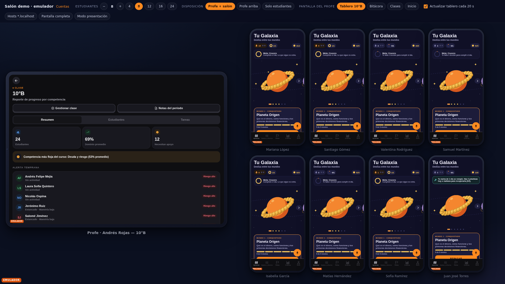

# Salón demo

Un salón completo de Ceti en tu computador: el profe en una tableta y hasta 24 estudiantes en teléfonos, cada uno con su propia cuenta y sesión, y un simulador que hace avanzar a la clase en vivo. Todo corre en los **emuladores locales de Firebase** con el proyecto `demo-ceti`. No toca producción y se puede repetir antes de cada presentación.



## Arranque

Usa tres terminales:

```bash
npm run salon:emuladores
```

```bash
npm run salon:sembrar
```

```bash
npm run salon:web
```

1. **`salon:emuladores`** compila `functions/` y levanta los emuladores de Auth (9098), Firestore (8099) y Functions (5001), más la UI en http://localhost:4000. Espera a que aparezca el mensaje "All emulators ready".
2. **`salon:sembrar`** borra el emulador y lo vuelve a llenar en unos 5 segundos. Puedes correrlo cuantas veces quieras. Así se limpia el salón entre una presentación y otra.
3. **`salon:web`** abre Expo web con `EXPO_PUBLIC_USE_EMULATORS=1` en **http://localhost:8085**. El puerto es propio a propósito: la sesión del emulador no se mezcla con la de producción que tengas abierta en `localhost:8081`.

Luego abre **http://localhost:8085/dev/salon**.

Para que la clase se mueva sola, abre una cuarta terminal:

```bash
npm run salon:simular
```

Este comando genera un evento cada unos 5 segundos: un estudiante termina una lección, vence al jefe de un mundo o entra por primera vez en días. Para presentar conviene un ritmo más rápido: `npm run salon:simular -- --cada 2`. Para enfocarlo en los teléfonos visibles: `-- --estudiantes 8`. Para otra clase: `-- --curso 9a`. Se detiene con **Ctrl+C**.

## Cuentas

Todas las cuentas usan la contraseña `salon-ceti-2026`. Solo existe en el emulador y está en [`scripts/salon/cuentas.json`](../scripts/salon/cuentas.json).

Para entrar con un toque, abre `http://localhost:8085/dev/entrar?cuenta=<id>`. Sin `cuenta`, la página lista todas las cuentas. Con `&ir=/bitacora` entra directo a esa pantalla. Si en una misma pestaña quieres usar dos cuentas a la vez, usa otro subdominio, por ejemplo `http://profe.localhost:8085/dev/entrar?cuenta=profe-piloto`.

| `cuenta=`                                            | Quién                                 | Para mostrar                                                                                                                                                                                                                                                                                                                                       |
| ---------------------------------------------------- | ------------------------------------- | -------------------------------------------------------------------------------------------------------------------------------------------------------------------------------------------------------------------------------------------------------------------------------------------------------------------------------------------------- |
| `profe-piloto`                                       | Andrés Rojas, Colegio San Mateo       | Capitán de 10°B y 9°A. El colegio tiene licencia Nave vigente (150 estudiantes) y él paga Piloto mensual con tarifa fundador (2 pagos aprobados). Tiene asignaciones, una pregunta propia en Luna del Presupuesto, el mundo propio "La tienda escolar", la Bitácora de esta semana y la anterior, y 3 invitaciones pendientes en la lista de 10°B. |
| `profe-cadete`                                       | Lucía Herrera, Colegio Los Andes      | Tiene 1 clase (8°A) y su prueba ya venció. Sirve para mostrar el plan Cadete, el muro de planes y el contenido en solo lectura.                                                                                                                                                                                                                    |
| `profe-prueba`                                       | Camilo Pérez, Colegio Nuevo Horizonte | Recién registrado: le quedan 9 días de la prueba de Piloto y tiene 1 clase (7°C).                                                                                                                                                                                                                                                                  |
| `admin`                                              | Equipo Ceti                           | Panel de administración con los 3 colegios.                                                                                                                                                                                                                                                                                                        |
| `estudiante` (= `est-1`)                             | Mariana López, 10°B                   | Racha de 15 días, meta del día cumplida, 4 mundos conquistados, Cetis y un CDT en la Bóveda.                                                                                                                                                                                                                                                       |
| `joven`                                              | Valentina Ríos, 20 años               | Joven B2C sin clase. Tiene 3 metas, aportes, 10 gastos, presupuesto y racha.                                                                                                                                                                                                                                                                       |
| `est-1` … `est-24`                                   | 10°B                                  | Avance variado: 1 destacada, 5 fuertes, 9 medios, 5 flojos (algunos llevan más de 14 días sin entrar), 3 sin actividad y 1 pendiente de atestación (`est-23`).                                                                                                                                                                                     |
| `est9a-1` … `est9a-12`                               | 9°A                                   | Una mezcla similar.                                                                                                                                                                                                                                                                                                                                |
| `andes-1` … `andes-6`, `horizonte-1` … `horizonte-4` | Clases de los otros profes            |                                                                                                                                                                                                                                                                                                                                                    |

## La vista del salón (`/dev/salon`)

Cada dispositivo es un iframe con su propio origen: `profe.localhost` para el profe y `e1.localhost` … `e24.localhost` para los estudiantes. Por eso cada uno tiene su propia sesión de Auth. Metro acepta esos hosts sin configuración extra, y Chrome, Edge y Firefox resuelven `*.localhost` solos.

La barra de arriba tiene estos controles:

- **Estudiantes:** de 4 a 24 (8 por defecto).
- **Disposición:** _Profe + salón_ (lado a lado), _Profe arriba_ o _Solo estudiantes_.
- **Pantalla del profe:** Tablero 10°B, Bitácora, Clases o Inicio.
- **Actualizar tablero cada 20 s:** el tablero del profe no escucha cambios en vivo, así que el salón lo recarga sin parpadeo (carga la versión nueva por detrás y luego la cambia).
- **Pantalla completa** y **Modo presentación:** el modo presentación oculta la barra y agranda los nombres. Para salir usa Esc o el botón "Salir".
- **Hosts:** cambia a `127.0.0.x` cuando el navegador no resuelve `*.localhost`. Safari es el caso típico.

La configuración queda en la URL. Por ejemplo, `/dev/salon?n=24&disposicion=arriba&presentacion=1` sirve como marcador para el día de la presentación.

Los teléfonos cargan escalonados, uno cada 0,6 s, porque cada uno es una app completa. Con 24 teléfonos el salón tarda cerca de un minuto en quedar listo, así que ábrelo antes de empezar.

## Guion de 10 minutos

**Antes de entrar (5 min antes):**

1. Levanta los emuladores y corre `salon:sembrar`.
2. Corre `salon:web`.
3. Abre `/dev/salon?n=12` y espera a que carguen todos los teléfonos.
4. Abre en otra pestaña `localhost:8085/dev/entrar?cuenta=profe-cadete&ir=/planes` para el minuto 7.
5. Deja lista la terminal con `npm run salon:simular -- --cada 2`, sin correrlo todavía.

| Min  | Qué abrir                                                 | Qué decir                                                                                                                                                                                          |
| ---- | --------------------------------------------------------- | -------------------------------------------------------------------------------------------------------------------------------------------------------------------------------------------------- |
| 0–1  | El salón en **Modo presentación**                         | "Este es un salón de 10°B del Colegio San Mateo: el profe Andrés y sus estudiantes, cada uno en su teléfono y con su cuenta."                                                                      |
| 1–3  | Teléfono de **Mariana** (e1). Toca su galaxia y su Bóveda | "Aprenden finanzas como en un juego. Mariana lleva 15 días de racha, ya conquistó 4 mundos y tiene Cetis en un CDT. Aprende ahorrando de verdad, con dinero virtual."                              |
| 3–5  | Arranca **el simulador**. Mira el tablero del profe       | "Mientras hablamos, la clase avanza. Cada 20 segundos el tablero del profe se actualiza: el dominio promedio sube y los que necesitan apoyo bajan. La alerta temprana le dice a quién buscar hoy." |
| 5–6  | Cambia la pantalla del profe a **Bitácora**               | "Cada domingo el profe recibe esto: cuántos se conectaron, cuánto tiempo le ahorró Ceti y qué mundo reforzar. No tiene que armar reportes."                                                        |
| 6–7  | Profe en **Tablero 10°B** y toca **Gestionar clase**      | "Él decide el orden de los mundos, crea los suyos (La tienda escolar), escribe preguntas propias y asigna retos con fecha. También invita por lista: hay 3 invitaciones pendientes."               |
| 7–8  | Pestaña de **profe-cadete** (`/planes`)                   | "Un profe puede empezar gratis. Cuando vence la prueba, nada se borra: queda en solo lectura y decide si sigue con Piloto. Andrés paga la tarifa fundador de $19.900 al mes."                      |
| 8–9  | `dev/entrar?cuenta=joven`                                 | "Fuera del colegio, Valentina, de 20 años, usa Ceti para sus metas: un viaje, un portátil y un fondo de emergencia."                                                                               |
| 9–10 | Vuelve al salón con `n=24`                                | "Un colegio con licencia Nave tiene esto en cada salón. Preguntas."                                                                                                                                |

Para repetir la presentación desde cero, corre `npm run salon:sembrar`. No hace falta reiniciar nada más.

## Problemas conocidos

**`ENOSPC: System limit for number of file watchers reached`.** Pasa cuando hay 2 o más servidores de Metro abiertos en la máquina. Tienes dos salidas:

- Arrancar sin watchers con `npm run salon:web -- --sin-watchers` (equivale a `CI=1`). El salón funciona igual, pero cada cambio de código exige reiniciar el servidor.
- Subir el límite de forma permanente en Linux:
  ```bash
  echo fs.inotify.max_user_watches=524288 | sudo tee /etc/sysctl.d/90-inotify.conf
  ```
  ```bash
  sudo sysctl --system
  ```

**Puerto 8099 ocupado (java zombi).** `salon:emuladores` revisa los puertos antes de arrancar. Si un emulador anterior quedó vivo, libera el puerto con `fuser -k 8099/tcp`. En Windows, `salon:emuladores` imprime el comando de PowerShell. También puede que ya estén arriba en otra terminal; en ese caso no hace falta levantarlos otra vez.

**Otra sesión usa el puerto 8085.** Cámbialo con `SALON_PUERTO=8090 npm run salon:web`. El salón toma el puerto de su propia URL, así que no hay nada más que tocar.

**`*.localhost` no resuelve (Safari).** Cambia a **Hosts 127.0.0.x** en la barra o usa `?hosts=loopback`. El profe queda en `127.0.0.2` y el estudiante n en `127.0.0.(10+n)`. En Linux funciona sin configurar nada. En macOS, los alias de loopback se crean con `sudo ifconfig lo0 alias 127.0.0.2 up` (uno por dirección).

**Un teléfono se quedó en "Cargando…".** Usa el botón ↻ que aparece al pasar el mouse sobre él.

**"Algo no cargó" en Clases del profe.** Pasaba cuando la regla de `cursos` no permitía consultar la lista `profesorUids array-contains uid`. Educadores la corrigió en `firestore.rules`. Si vuelve a pasar, revisa que el emulador tenga las reglas actuales: las recarga solo al guardar el archivo.

**La estudiante pendiente (`est-23`) muestra un error rojo de desarrollo.** Mientras está pendiente de atestación, las reglas le niegan la configuración de la clase y una suscripción sin manejo de error deja la superposición roja de desarrollo. Es un bug de la app (reportado). Para presentar, usa `n` ≤ 22 o explícalo como "así ve la app a un estudiante sin autorización del acudiente".

**Las metas de Valentina salen en $0.** La sincronización remota de la app reconstruye las metas con `currentAmount: 0` y no suma los aportes guardados en `deposits`. Es una limitación de la app, no de la siembra: los aportes están en el emulador.

## Cómo funciona

- **Cliente** (`src/shared/lib/firebase/app.ts`): con `EXPO_PUBLIC_USE_EMULATORS=1` usa el proyecto `demo-ceti` y conecta Auth, Firestore y Functions al host de la página. Si la página está en `127.0.0.x`, los conecta a `127.0.0.1`. En web muestra un distintivo **EMULADOR** abajo a la izquierda. Sin la variable, la app queda igual que siempre.
- **Siembra** (`scripts/salon/sembrar.ts`):
  - Usa firebase-admin contra los emuladores. Las variables `FIRESTORE_EMULATOR_HOST` y `FIREBASE_AUTH_EMULATOR_HOST` siempre están puestas y el proyecto es `demo-*`, así que no puede llegar a producción.
  - Escribe claims y colecciones reales con las funciones puras de la app y del servidor: `buildWorldProgress`, `completarPractica`/`alAbrir` de Órbita, y `nuevaSuscripcion`/`aplicarPagoAprobado`/`cicloDiario` de cobros.
  - Los agregados de curso los calcula el disparador real `onProgressWriteAggregate` en el emulador de Functions. La adopción y la Bitácora salen de llamar a `recalcularAdopcionColegio` y `bitacoraDeProfe`.
  - El contenido global (bancos, Elige camino y micro-teoría) se carga desde `content/`.
- **Simulador** (`scripts/salon/simular.ts`): escribe lo mismo que la app al terminar una práctica. Cada 5 eventos regenera la Bitácora de la semana.
- **Estado de juego:** un solo documento, `users/{uid}/juego/orbita`, construido con el dominio de Órbita. Al iniciar sesión en un teléfono nuevo gana el remoto: se corrigió en bb7df02, a partir de un reporte de esta sesión.

## Capturas

Están en [`salon-capturas/`](salon-capturas/) y se tomaron el 2026-10-22 con Playwright contra los emuladores:

- `salon-8.png` y `salon-8-tras-simulador.png`: un minuto de simulador con `--cada 1.5`. El tablero del profe, que se recarga solo cada 20 s, pasó de 69 % a 81 % de dominio, y los estudiantes que necesitan apoyo bajaron de 12 a 6.
- `salon-24-presentacion.png` y `salon-12-profe-arriba.png`: las otras disposiciones.
- `profe-piloto-tablero.png`, `profe-piloto-bitacora.png`, `profe-cadete-planes.png`, `profe-prueba-inicio.png` (con el aviso "Te quedan 9 días de Piloto"), `admin.png`, `estudiante-mariana.png`, `joven-inicio.png` y `entrar-cuentas.png`.
